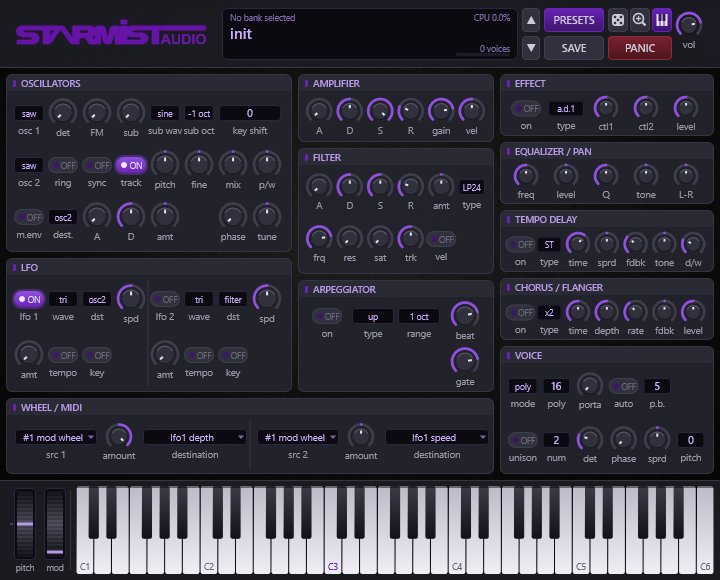
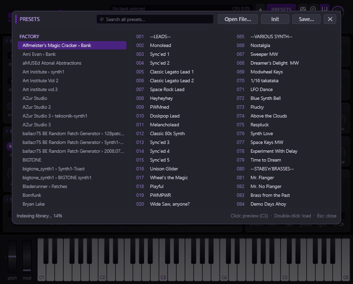
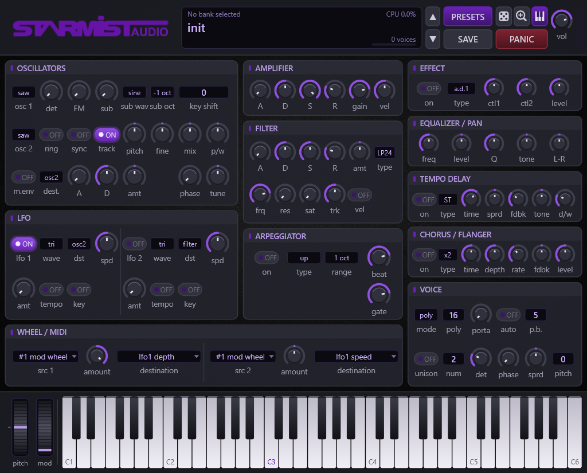

# Starmist Audio – ClassicSynth 1.0



ClassicSynth is a VST3 instrument for Windows (x64) that re-implements the sound architecture
and preset formats of **Synth1 V1.13** by Daichi. It loads and saves Synth1 presets, so the
large library of community `.sy1` patches and `.zip` banks plays the same way in a modern
VST3 host. 
Disclaimer: This was a personal project. I do not monetize this in any way. Synth1 is originally free, let's keep it that way.

The work is based on a static analysis of the original Synth1 64-bit DLL. Its parameter
table, value curves, voice and effect routing, and chunk format were recovered and then
written again from scratch in C++. The plugin contains no Synth1 code. The project's
toolchain, including the reverse-engineering tools used to make it, is described below.

## Features

* **Synth1-compatible engine**: 2 oscillators plus a sub oscillator (ring, sync and FM),
  LP12/LP24/HP12/BP12/LPDL filter, three envelopes, two LFOs, an arpeggiator, up to 32 voices
  (poly/mono/legato), and the effect chain (distortion, decimator, ring mod, compressor,
  phaser → EQ → pan → delay → chorus).
* **Preset formats**: `.sy1` text patches, Synth1 VST chunks, `.fxp` / `.fxb` (fxID `S1Vs`,
  readable by Synth1 itself), and read-only `.zip` banks with older patch versions upgraded
  automatically.
* **Modern UI**: a 720 × 480 dark Direct2D editor with zoom levels, a built-in preset browser,
  and an optional strip with pitch/mod wheels and a 61-key keyboard.
* **VST3 integration**: VST3 parameter IDs match Synth1 patch IDs, MIDI CC, aftertouch and
  pitch bend are mapped through `IMidiMapping`, and level meters are exposed as output parameters.
* **MSI installer** (WiX v5) with an install-folder chooser and repair/remove.

| Main editor | Preset browser | Large zoom |
|---|---|---|
|  |  |  |

## Repository layout

```
assets/        source artwork (background, logo, product image)
screenshots/   editor captures produced by the test harness
scripts/       build.ps1 (plugin + MSI), make-icon.ps1
vsproject/     Visual Studio 2022 solution, sources, tests, installer
  src/         params, dsp, presets, processor, controller, ui
  docs/        ReverseEngineering.md – the full analysis notes
  external/    Steinberg VST3 SDK (MIT), miniz (MIT)
  installer/   WiX v5 MSI project
  tests/       EngineTest (round-trips, renders, validation, screenshots)
.mcp.json      REA MCP server configuration used during development
```

More build and test detail is in [`vsproject/README.md`](vsproject/README.md).

## Building

You need Visual Studio 2022 (or Build Tools 2022) with the C++ desktop workload. To build the MSI
you also need the .NET 8 SDK.

```powershell
powershell -ExecutionPolicy Bypass -File scripts\build.ps1          # Release plugin + MSI
powershell -ExecutionPolicy Bypass -File scripts\build.ps1 -NoMsi   # plugin only
powershell -ExecutionPolicy Bypass -File vsproject\tests\build-and-run.ps1   # tests
```

The bundle is written to `vsproject\build\Release\ClassicSynth.vst3`. Copy it to
`C:\Program Files\Common Files\VST3` or install the MSI from `vsproject\installer\bin\`.

### Files not included in this repository

These folders are in `.gitignore` because their contents belong to other people. `original/` and
`presets/` keep their folder structure through empty `.gitkeep` files, so you can see where
everything goes:

* `original/` holds the Synth1 V1.13 distribution (`Synth1 VST64.dll`, the readmes and the
  soundbanks). Download it from Daichi's site (<https://daichilab.sakura.ne.jp/>).
  You only need it if you want to repeat the reverse-engineering analysis.
* `presets/` and `zipbank/` hold community Synth1 preset libraries (unpacked folders and the
  original `.zip`/`.rar` banks). Development builds link these two folders into the bundle as
  factory presets. Put your own Synth1 banks there, or leave them empty.

## How it was made: reverse-engineering toolchain

The behaviour of the original plugin was recovered from `Synth1 VST64.dll`
("V1.13 64bit beta3 2014.7", image base `0x180000000`). An AI coding agent (Claude Code)
drove the analysis through the tools below. All findings are documented in
[`vsproject/docs/ReverseEngineering.md`](vsproject/docs/ReverseEngineering.md).

### REA – Reverse Engineering Agent MCP server

[REA](https://github.com/morluto/rea) (`rea-agents` on npm, version 6.7.0 here) is a
reverse-engineering toolkit available both as a command-line tool and as an
MCP (Model Context Protocol) server. Through MCP, an AI agent can open a binary and work on it
with structured tool calls instead of operating a disassembler GUI by hand. It covers native
PE/ELF/Mach-O binaries, managed code, firmware, WebAssembly, web bundles, Android and live
runtimes (Frida, GDB, rizin). Each result returns with evidence and coverage notes, so the
agent's findings can be checked.

For ClassicSynth, REA was used to:

* open the DLL and produce a binary overview (segments, exports, RTTI class names such as
  `Synth1VST`, `CSynthesizer1`, `CVoice`, `CVcf`, `CLFO`, `CDelay`, `CChorus`);
* run `batch_decompile` across all 981 application procedures;
* follow call paths and cross-references from `VSTPluginMain` → `createEffectInstance` →
  `Synth1VST::Synth1VST`, and through `CSynthesizer1::setParameter` to recover every
  parameter's value curve;
* read `.data`/`.rdata` tables directly: the 98-entry parameter table, the delay-time and
  LFO tempo tables, and the GUI option-string pool.

The server is configured in [`.mcp.json`](.mcp.json):

```json
{
  "mcpServers": {
    "rea": {
      "type": "stdio",
      "command": "cmd",
      "args": ["/c", "rea", "--mcp"],
      "env": {
        "GHIDRA_INSTALL_DIR": "C:\\ghidra-dl\\ghidra_12.1.4_PUBLIC",
        "JAVA_HOME": "C:\\Program Files\\Eclipse Adoptium\\jdk-25.0.4.101-hotspot"
      }
    }
  }
}
```

Install it with `npm install -g rea-agents`, then change the two paths to match your machine.

### Ghidra – decompiler backend

[Ghidra](https://github.com/NationalSecurityAgency/ghidra) (version 12.1.4) is the NSA's
open-source software reverse-engineering framework. It provides disassembly, a C decompiler,
data-type recovery and a scripting API. REA runs Ghidra **headless**, without its GUI, as the
analysis engine for native binaries. Ghidra performs auto-analysis and decompilation, and REA
passes the pseudo-code, call graphs, xrefs and memory reads to the agent. Ghidra needs a Java
runtime: Eclipse Adoptium JDK 25 was used, set through `JAVA_HOME` as shown above.

Analysis results that were derived directly from the binary include the following:

* the plugin identity: uniqueID `'S1Vs'`, 255 parameters, and `programsAreChunks | isSynth`;
* the audio graph: 32 `CVoice` instances → `CMixDevice` → `CEffector` → `CEq` ×2 → `CPan`
  → `CDelay` → `CChorus`;
* the envelope state machine and its piecewise release slope, and the filter-cutoff table
  (`15 Hz · b^(i/1024)`);
* the `.sy1` reader/writer, and the 0xA40-byte VST chunk layout (`makeVSTChunkData`), including
  the legacy DXi header.

Some values could not be pinned down exactly. ClassicSynth uses a reasoned substitute for each
of them, and those values are marked *(chosen)* in the notes.

## Legal

ClassicSynth is an independent, clean re-implementation built for interoperability with
Synth1 presets, and it is a personal-use build. Synth1 is © Daichi. Preset banks belong to
their respective authors. Third-party components are the Steinberg VST3 SDK (MIT) and miniz
(MIT). The software is provided "as is", without warranty of any kind.
